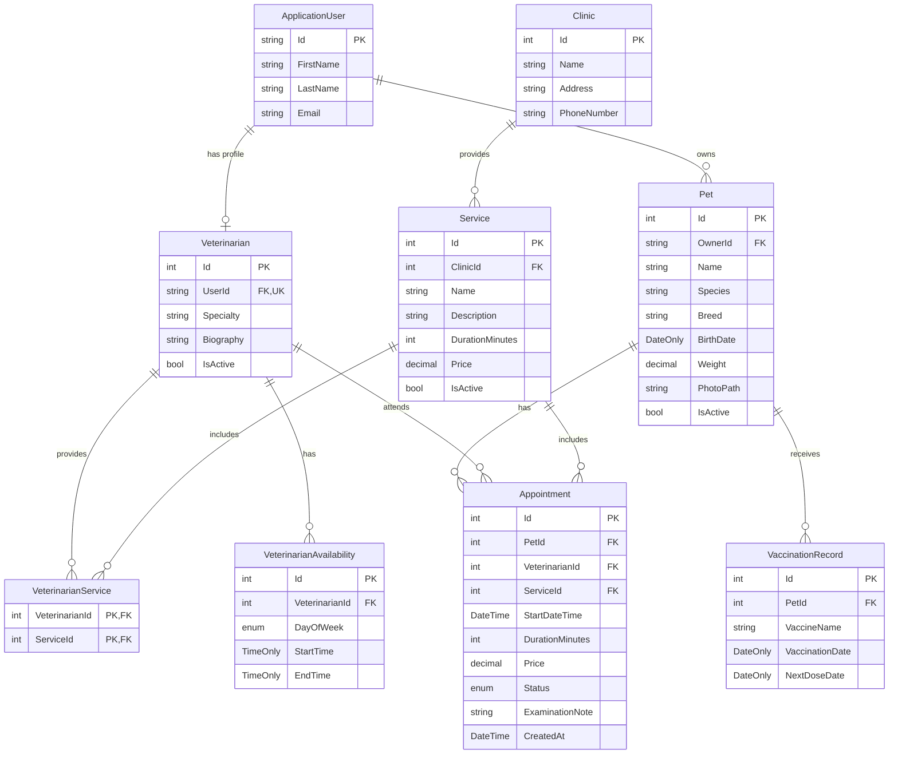

# Veteriner Kliniği Randevu ve Hasta Takip Sistemi

## Proje Tanıtımı

ASP.NET Core MVC kullanılarak geliştirilen bu proje, veteriner kliniğinin hizmet, veteriner, hayvan, aşı ve randevu işlemlerinin yönetilmesini amaçlamaktadır.

## Kullanılan Teknolojiler

- ASP.NET Core MVC (.NET 10)
- C#
- SQL Server
- Entity Framework Core (Code First ve Migrations)
- ASP.NET Core Identity
- LINQ
- REST API
- Model Context Protocol (MCP)
- Bootstrap 5
- HTML, CSS, JavaScript ve jQuery

## Veritabanı Tasarımı

Sistem tek klinik üzerinden çalışacak şekilde tasarlanmıştır.

ApplicationUser, ASP.NET Core Identity altyapısındaki AspNetUsers tablosunu temsil etmektedir. Identity'nin diğer sistem tabloları diyagramda gösterilmemiştir.

## Planlanan Temel İş Kuralları

- Kullanıcılar Admin, Veterinarian ve Member rollerine sahip olacaktır.
- Hayvan sahipleri yalnızca kendi hayvanlarına ve randevularına erişebilecektir.
- Veterinerler yalnızca yetkin oldukları hizmetleri verebilecektir.
- Randevular veterinerin çalışma saatlerine uygun olmalıdır.
- Çakışan randevular oluşturulamayacaktır.
- Yeni randevular Pending durumunda başlayacaktır.
- Randevu oluşturulduğu andaki hizmet ücreti ve süresi korunacaktır.
- Geçmiş sağlık ve randevu kayıtlarının bütünlüğü korunacaktır.
- MVC, REST API ve MCP ortak servis katmanını kullanacaktır.

## Proje Durumu

Proje geliştirme aşamasındadır. Veritabanı tasarımı hazırlanmış olup uygulama özellikleri aşamalı olarak geliştirilecektir.
